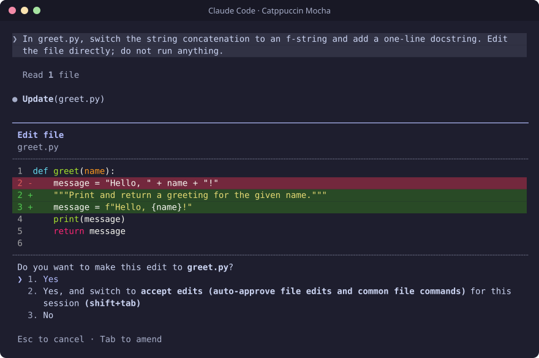
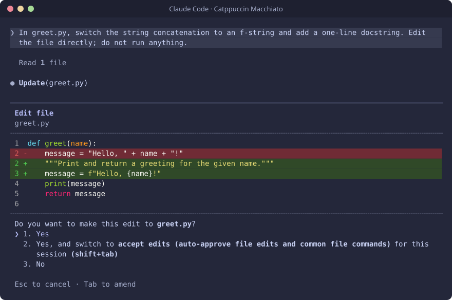
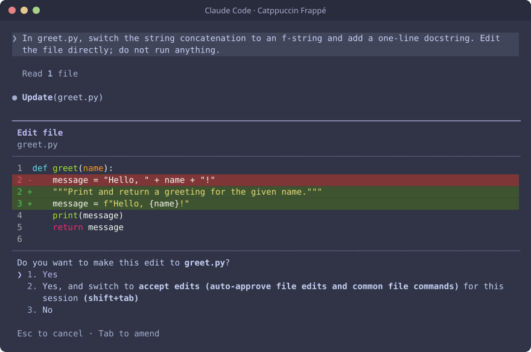
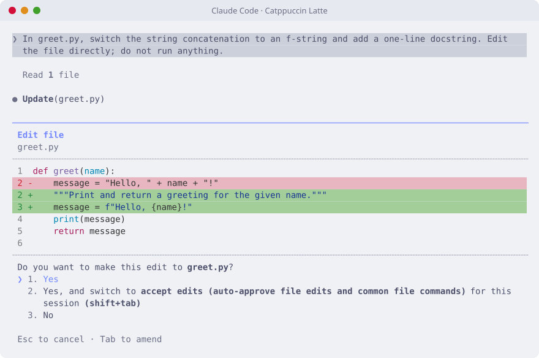

# Catppuccin for Claude Code

[Catppuccin](https://catppuccin.com) themes for the Claude Code terminal UI. All
four flavours are included, and each one sets all 72 colours Claude Code lets a
theme change.

## Previews

| Mocha | Macchiato |
|---|---|
|  |  |
| **Frappé** | **Latte** |
|  |  |

## Requirements

- Claude Code 2.1 or newer (any version with custom theme support)
- `bash`, plus `curl` or `wget` for the one-line install
- `python3` or `jq` if you want the installer to switch the theme on for you

## Installation

### Quick install

```sh
curl -fsSL https://raw.githubusercontent.com/vishwajitsarnobat/catppuccin-claude-code/main/install.sh | bash -s -- --activate mocha
```

This installs all four flavours and makes Mocha the active theme. Replace
`mocha` with `macchiato`, `frappe` or `latte` to start with a different one. To
install the themes without switching to any of them, drop `--activate mocha`.

### From a clone

```sh
git clone https://github.com/vishwajitsarnobat/catppuccin-claude-code.git
cd catppuccin-claude-code
./install.sh --activate mocha
```

### Manual

1. Download the flavour you want from the [`themes`](themes) folder.
2. Copy it into `~/.claude/themes/`, creating the folder if it does not exist.
3. Open Claude Code, run `/theme` and pick the flavour.

You can also set it directly in `~/.claude/settings.json`:

```json
{
  "theme": "custom:catppuccin-mocha"
}
```

## Usage

Run `/theme` in Claude Code to switch between flavours. Changes apply straight
away, so there is no need to restart.

### Match your terminal

Claude Code colours its own interface but not the terminal behind it. For the
theme to look right, your terminal background should match the flavour. The
easiest way is to use the Catppuccin theme for your terminal from
[catppuccin.com/ports](https://catppuccin.com/ports). If you would rather not,
set the background colour by hand:

| Flavour | Background |
|---|---|
| Mocha | `#1e1e2e` |
| Macchiato | `#24273a` |
| Frappé | `#303446` |
| Latte | `#eff1f5` |

Your terminal also needs truecolour support. Most modern terminals have it. If
colours look slightly off, check that `COLORTERM=truecolor` is set.

## Installer options

| Option | Description |
|---|---|
| `-f`, `--flavour NAME` | Install only this flavour. Can be repeated. |
| `-a`, `--activate [NAME]` | Make `NAME` the active theme. The name can be left out when installing a single flavour. |
| `-d`, `--dir PATH` | Install into `PATH` instead of `~/.claude/themes`. |
| `-l`, `--list` | List the available flavours. |
| `-h`, `--help` | Show help. |

If your Claude Code config lives somewhere other than `~/.claude`, set
`CLAUDE_CONFIG_DIR` and both scripts will use it.

The installer only changes the `theme` key in `settings.json`. Everything else
in the file is kept as it is, and a symlinked `settings.json` stays a symlink.

## Uninstall

```sh
./uninstall.sh
```

This removes the four theme files. If one of them was active, the theme is set
back to Claude Code's built-in `dark` theme, or `light` if you were using Latte.
Use `--keep-setting` to leave `settings.json` untouched, or `--fallback NAME` to
choose which built-in theme to go back to.

## Troubleshooting

**The theme does not show up in `/theme`.** Check that the file is in
`~/.claude/themes/` (or `$CLAUDE_CONFIG_DIR/themes/`) and that your Claude Code
version supports custom themes.

**Colours look washed out inside tmux.** Claude Code uses 256 colours instead of
truecolour when it runs inside tmux, so the shades are approximate there.

**Code in diffs is not in Catppuccin colours.** Claude Code picks the colours for
highlighted code itself (Monokai for dark themes, GitHub for light ones) and a
theme cannot change them. To turn code highlighting off, add
`"syntaxHighlightingDisabled": true` to `settings.json`. The red and green diff
lines still use the Catppuccin colours.

## How the colours are chosen

No colour here is picked by eye. The themes are generated by
`scripts/generate.py` from the official
[Catppuccin palette](https://github.com/catppuccin/palette) (v1.8.0):

- Most colours map straight onto a palette colour. Claude's orange becomes
  Peach, errors are Red, plan mode is Teal, and so on.
- Shimmer colours, used by the animated spinner, are each accent mixed with the
  lightest colour in the flavour.
- Diff and message backgrounds have no palette equivalent. They keep the hue of
  the matching accent and are darkened (or lightened, for Latte) until text on
  them stays readable and the band is still clearly visible.

Most ports mix the accent over the background to get these backgrounds. With
Catppuccin that turns removed lines purple instead of red, which is why this
port does it differently.

Text contrast on the diff backgrounds:

| Flavour | Changed line | Changed word |
|---|---|---|
| Mocha | 6.91:1 | 4.51:1 |
| Macchiato | 6.71:1 | 4.51:1 |
| Frappé | 5.53:1 | 4.53:1 |
| Latte | 4.51:1 | 3.42:1 |

Latte's changed-word highlight is below the usual 4.5:1 target. Lightening it
enough to pass would make it impossible to tell apart from the line around it.

## Development

Only Python 3 is needed.

```sh
python3 scripts/generate.py           # rebuild themes/ from the palette
python3 scripts/generate.py --check   # fail if themes/ is out of date
python3 scripts/validate.py           # check the theme files
./scripts/screenshots.sh              # retake the previews (needs claude and tmux)
```

Files in `themes/` are generated, so edit `scripts/generate.py` instead and
regenerate. `validate.py` checks the theme files independently of the
generator. That matters because Claude Code silently ignores any colour name it
does not recognise, so a typo would otherwise go unnoticed.

## Credits

Colours from [Catppuccin](https://github.com/catppuccin/catppuccin).

## License

[MIT](LICENSE)
